# Out Of Fun Dashboard

**A desk dashboard on a Raspberry Pi 4 and the 7" Touch Display 2: the time, weather, calendars, music, photos, the 3D printer and the desk lights, on one Apple-like touch screen.** It runs on a custom Yocto Linux with A/B over-the-air updates that roll back by themselves.

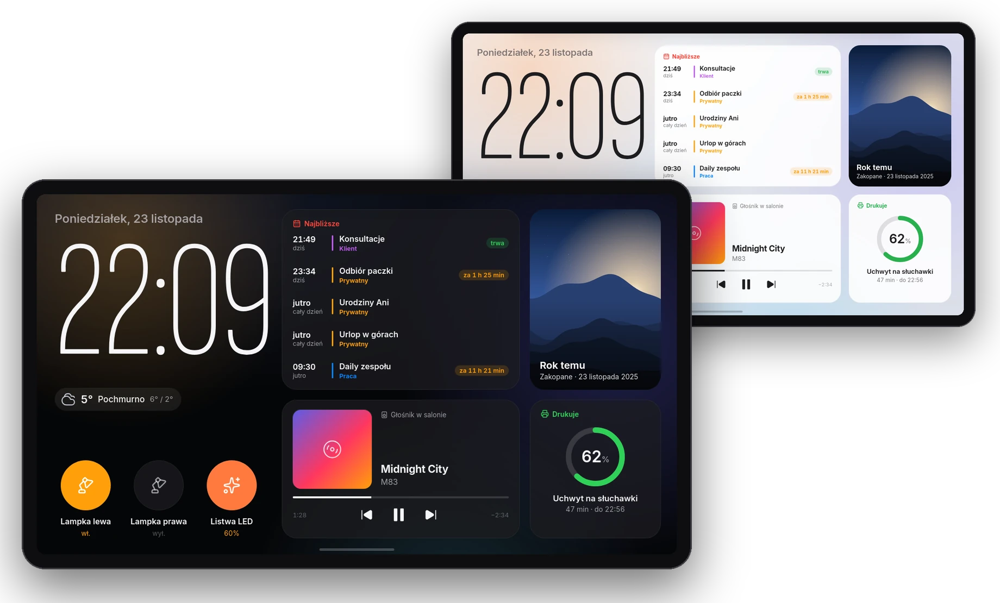

<sub>All screenshots show test data. The interface is in Polish.</sub>

## What it does

- **Summary.** The page in the middle: a large thin clock, the weather in one line, the three desk lights, the next five events, a photo memory, the music playing and the 3D printer.
- **Pages you swipe between**, in this order: Home, Printer, Calendar, *Summary*, Weather, Music, Photos.
  - Swipe up, or double tap, for an overview of all pages around the summary.
  - Pull down from the top edge for a control bar with the theme, the screen brightness and the screensaver.
- **Weather** from Open-Meteo:
  - a 24-hour chart whose curve turns from warm to lavender at night, with rain bars and the amount of rain;
  - tiles for UV, wind, pressure, sunrise and sunset, and rain;
  - a 7-day forecast.
- **Calendars** from published ICS links (Outlook, Google, iCloud):
  - day, week and month views, with filter chips per calendar and all-day events as bars across the days;
  - a details sheet for an event, with the full description and Outlook's Teams footer cut off.
- **Music** through the Spotify Web API:
  - what plays and on which device, with play/pause/skip and the volume;
  - the device picker;
  - your playlists, liked songs and recently played albums. Open one to see its tracks and play it from any track.
- **Photos** from a self-hosted [Immich](https://immich.app): a random batch of landscape photos from the whole library every 30 minutes, plus "N years ago" memories. Tap left or right to go back or on.
- **Screensaver** after 5 minutes without touch: full-screen photos with crossfade and a slow zoom, the clock, the date and the weather in a corner.
- **3D printer:** a Bambu Lab printer read over its local MQTT broker, which works in the printer's normal cloud mode.
  - The job, progress, layers and time left.
  - Both nozzles, the bed and the chamber.
  - The AMS spools in their real filament colours and the AMS humidity.
  - Errors.
- **Home:** two desk lamps (on/off) and an RGBW LED strip with Control Center-style brightness and white pills, colour swatches and a hue strip. The lights are a mock until the hardware is there.
- **Themes:** light and dark, switching on their own at sunrise and sunset.

## Screenshots

| | |
|:---:|:---:|
| 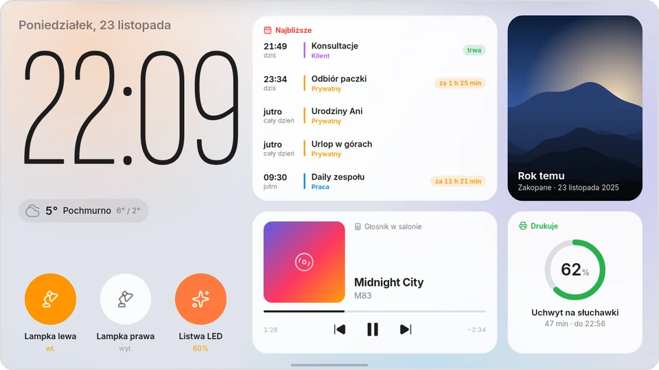 | 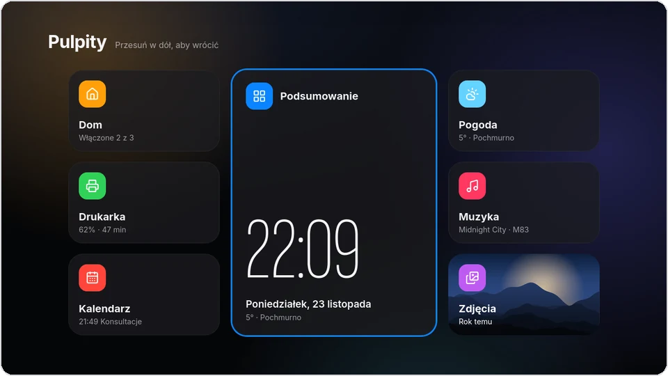 |
| Summary, light theme | Overview of the pages |
| 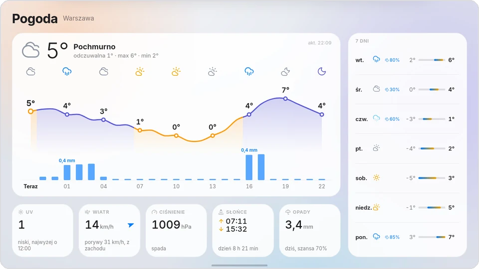 | 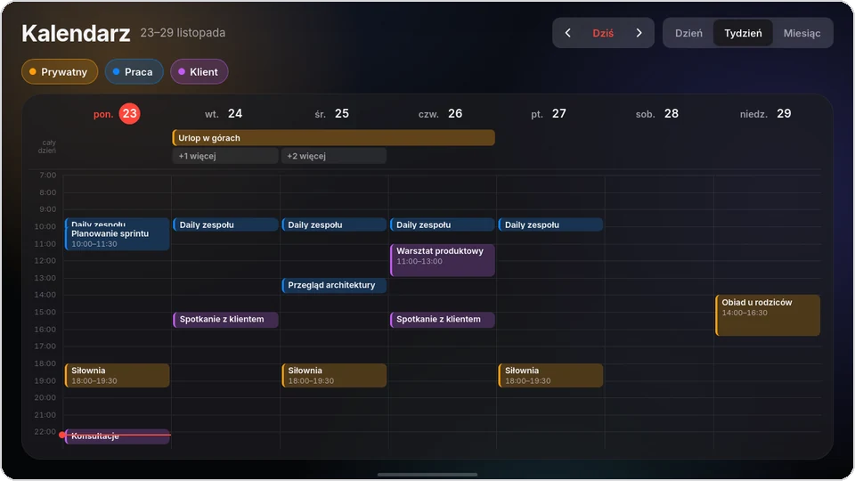 |
| Weather: 24-hour chart and the day's details | Calendar, week view |
| 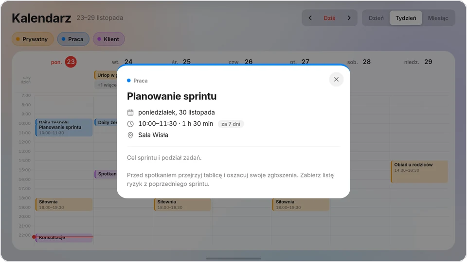 | 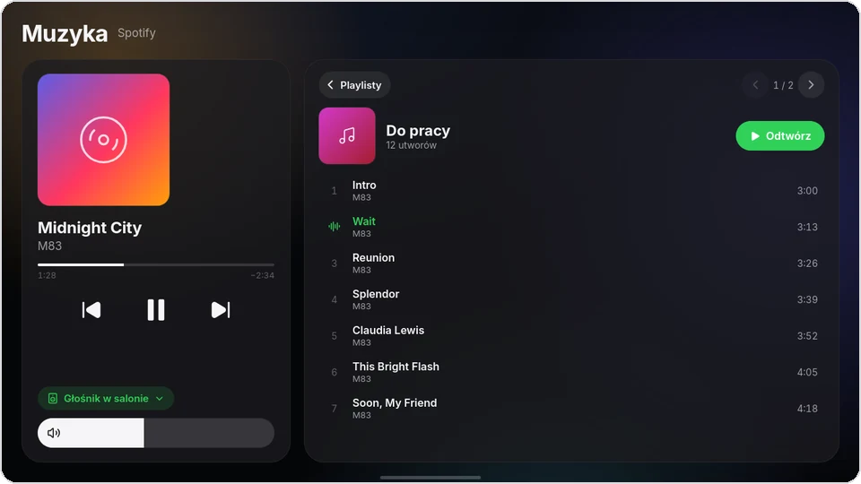 |
| Details of an event | Music: a playlist opened to its tracks |
| 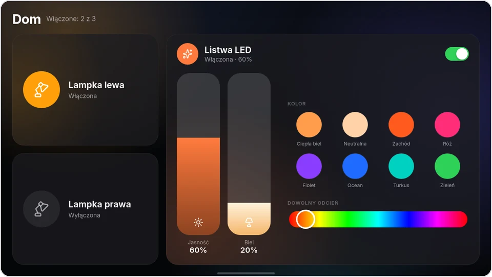 | 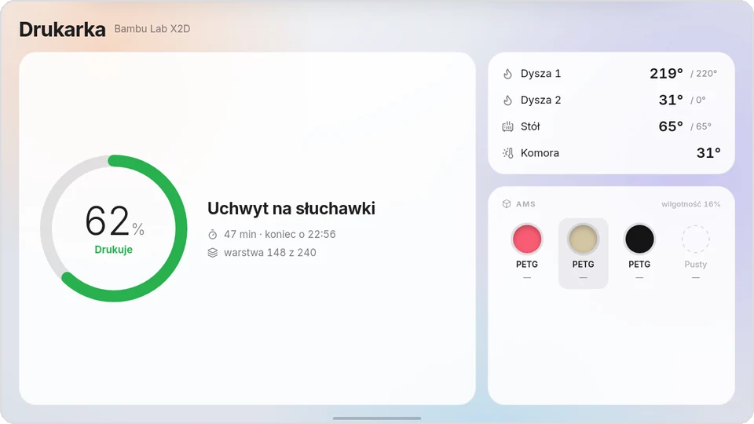 |
| Home: lamps and the RGBW strip | 3D printer: progress, temperatures, AMS |
| 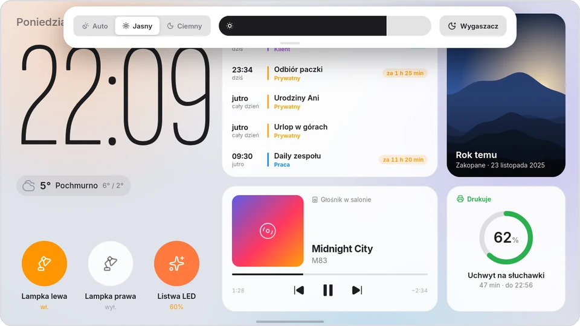 | 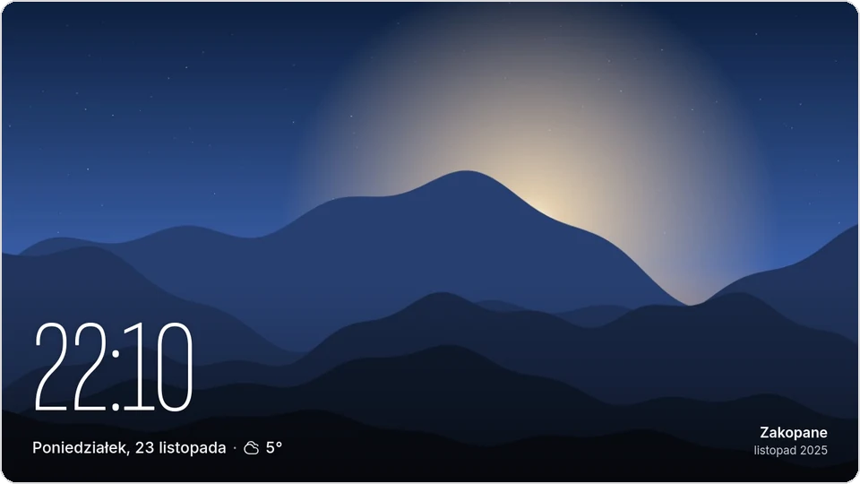 |
| Control bar, pulled down from the top | Screensaver |

## Hardware

| Part | |
|---|---|
| Computer | Raspberry Pi 4 Model B, 2 GB |
| Screen | Raspberry Pi Touch Display 2 (7", 1280×720, used in landscape) |
| Storage | microSD card: boot partition, two root file systems (A/B) and a data partition |

## How it works

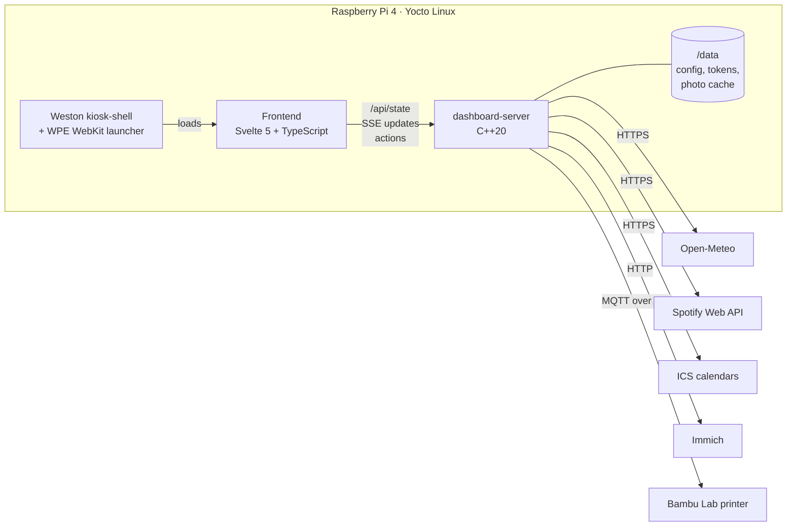

- **Frontend:** Svelte 5 + TypeScript + Vite, built to static files.
  - It never talks to the internet. It loads the state from the local server once and then follows Server-Sent Events.
  - API keys and tokens never reach the browser, and there is no CORS to deal with.
- **Server:** C++20 (meson) with cpp-httplib, libcurl, nlohmann/json, libical and Eclipse Paho MQTT.
  - Each data source is a small provider thread that refreshes at its own pace and publishes changes.
  - It also serves the frontend and sets the screen backlight through sysfs.
- **Kiosk:** Weston's kiosk shell runs a small launcher written against the WPEPlatform API of WPE WebKit.
- **OS:** a Yocto (Wrynose) distribution with U-Boot and RAUC.
  - A/B root file systems, signed and verity-protected update bundles, and a boot-time health check with a hardware watchdog.
  - An update that does not come up healthy is rolled back by U-Boot after three tries; tested with forced panics, a hung kiosk and power cuts.
  - Power on to dashboard takes about 18 s.

### Made smooth on a Pi 4

The UI was tuned with a built-in benchmark (`?bench`), which plays the transitions and logs the frame rate on the device. What helped:

- **No blurred shadows** on anything large. WebKit paints blur slowly on the Pi, and a page of cards with 40 px shadows stalled every swipe for 100–200 ms. Cards are flat, with a 1 px hairline, like iOS widgets.
- **Only `transform` and `opacity` animate**, and elements that animate keep a layer, so nothing is painted at the start of an animation.
- **Paint first, then animate:** after choosing a page in the overview, or when waking from the screensaver, the page is painted under the cover before the transition starts.

| Transition (frames per second / longest frame) | Before | After |
|---|---|---|
| Swiping between pages | 43 / 217 ms | 54 / 117 ms |
| Overview | 36 / 280 ms | 47 / 168 ms |
| Control bar | 60 / 60 ms | 61 / 39 ms |

## Repository

```
01_Software/
├── dashboard/
│   ├── web/        frontend (Svelte 5 + TypeScript)
│   ├── server/     dashboard-server (C++20), with tests
│   ├── tools/      kiosk-url.sh (show a dev build on the Pi), spotify-login.py
│   └── docs/       plan.md: architecture, decisions and measurements (Polish)
├── launcher/       full-screen WPE WebKit launcher
├── yocto/
│   ├── meta-dashboard/   the Yocto layer: distro, image, recipes, RAUC, U-Boot
│   ├── tools/            ota.sh (install an update over SSH), rauc-keys.sh
│   ├── docs/             ota-rauc.md: the A/B update design and its rollback tests
│   ├── build.sh          builds in a container
│   └── flash.sh          writes an image to the SD card
└── spike/          early rendering benchmarks for WPE on the Pi
03_Docs/images/     the pictures in this README
```

## Trying it

The frontend runs on any PC with test data:

```bash
cd 01_Software/dashboard/web
npm install
npm run dev
# open http://localhost:5173/?mock
```

Useful address parameters:

| Parameter | What it does |
|---|---|
| `?page=weather` | the page to start on |
| `?overview` | open the overview |
| `?saver` | start the screensaver |
| `?theme=light` / `?theme=dark` | force a theme |
| `?demo` | test data without the "test data" badge |

The rest are listed in [the plan](01_Software/dashboard/docs/plan.md).

The server builds natively with meson. Its configuration (location, Immich, Spotify, printer, calendar links) lives in a `config.json` outside the repository. See [the dashboard README](01_Software/dashboard/README.md).

The image builds with `01_Software/yocto/build.sh`, and updates install with `tools/ota.sh`. See [the OTA design](01_Software/yocto/docs/ota-rauc.md).

## Credits

- [Inter](https://rsms.me/inter/) (OFL) and other OFL fonts for the clock
- [Lucide](https://lucide.dev) icons (ISC)
- [cpp-httplib](https://github.com/yhirose/cpp-httplib) (MIT)
- Weather data by [Open-Meteo](https://open-meteo.com)
